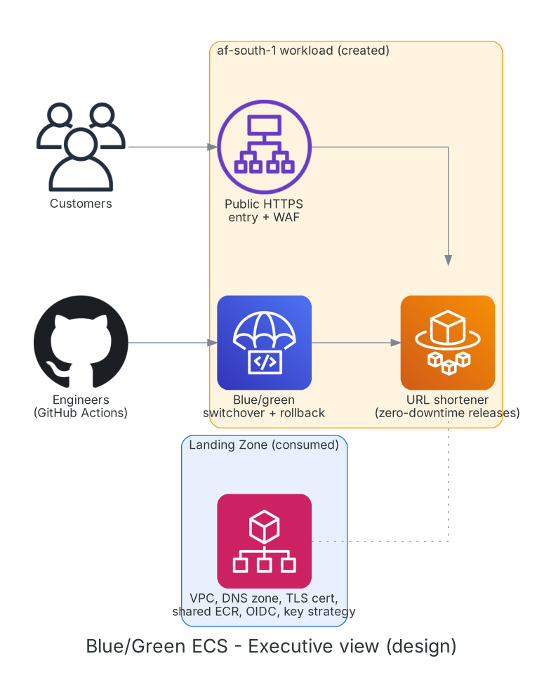
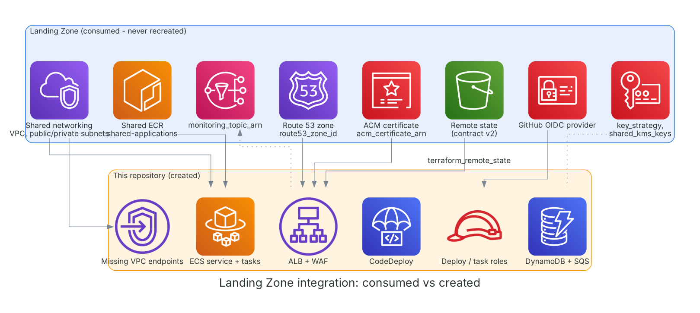
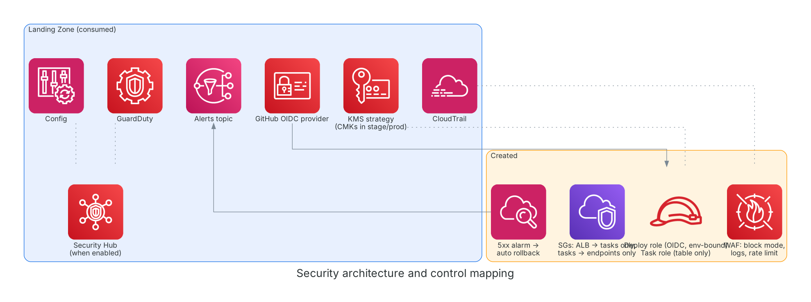
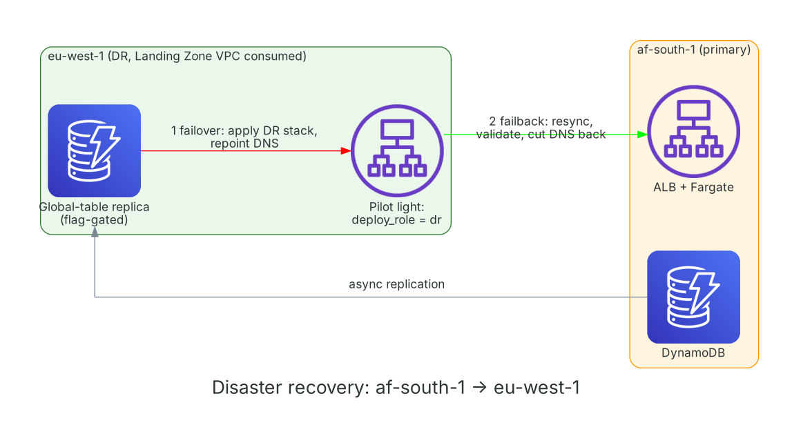

# aws-ecs-blue-green-deployment

### Zero-downtime blue/green releases of a containerised URL shortener on ECS Fargate, deployed into an existing AWS Landing Zone in af-south-1 with eu-west-1 as DR

---

## Architecture



**Executive view.** Customers reach a public HTTPS entry protected by WAF; engineers ship new versions through GitHub Actions and CodeDeploy, which starts a "green" copy, shifts traffic to it and keeps the "blue" copy for instant rollback. Blue is consumed from the Landing Zone, amber is created here. All diagrams show the intended design.



**Landing Zone integration.** The VPC and subnets, Route 53 zone, ACM certificate, shared ECR repository, GitHub OIDC provider, key strategy and alerts topic are read from the Landing Zone's remote state and never recreated. Inventory and gaps: [docs/landing-zone-integration.md](docs/landing-zone-integration.md).



**Security architecture.** WAF in block mode, private Fargate tasks with no public IP, security groups that only allow ALB to tasks and tasks to endpoints, a least-privilege task role, an OIDC deploy role bound to one GitHub environment, and a 5xx alarm that rolls a bad release back automatically. Threat model: [docs/threat-model.md](docs/threat-model.md).



**Disaster recovery.** af-south-1 is primary. eu-west-1 (the Landing Zone's DR VPC) is a pilot light: the same stack with `deployment_role = "dr"` plus an optional DynamoDB global-table replica. RPO about 1 second with the replica, RTO about 60 minutes (design targets, not measured). [docs/dr-and-resilience.md](docs/dr-and-resilience.md).

More: [logical](architecture/diagrams/logical-architecture.png), [network](architecture/diagrams/network-architecture.png), [data flow](architecture/diagrams/data-flow-diagram.png), [Terraform deployment](architecture/diagrams/terraform-deployment-diagram.png).

---

## Contents

- [Status and honesty notes](#status-and-honesty-notes)
- [What changed from the original project](#what-changed-from-the-original-project)
- [Regions and the Ireland rule](#regions-and-the-ireland-rule)
- [Encryption and FinOps](#encryption-and-finops)
- [Tech stack](#tech-stack)
- [Repository layout](#repository-layout)
- [Deploying](#deploying)
- [How a blue/green release works](#how-a-bluegreen-release-works)
- [Architecture decisions](#architecture-decisions)
- [Documentation](#documentation)
- [Origin](#origin)

## Status and honesty notes

- Formatted with OpenTofu, statically checked (every variable, local and module argument resolves), workflows parsed as YAML, app tests pass (6). **`terraform validate` and `plan` were not run**: the provider registry was unreachable where this was written. Run both against your Landing Zone state before any apply. CI also runs `validate`.
- Landing Zone gaps found: no CMKs exported (stage and prod plans fail by design), no interface endpoints, no NAT, Security Hub disabled, log buckets only in us-east-1, no GitHub deploy roles. Details in [docs/landing-zone-integration.md](docs/landing-zone-integration.md).
- Assumption to confirm: the Landing Zone ACM certificate covers `<app_subdomain>.<Landing Zone domain>` (a wildcard, or add the name). Terraform cannot check this.
- Not verified in af-south-1: ARM64 on Fargate (the task is pinned to x86_64).

## What changed from the original project

The original created its own VPC, subnets, internet gateway, ACM certificate, DNS records, ECR repository, GitHub OIDC provider, state bucket, lock table and an S3 bucket for CodeDeploy, all in eu-west-1 with account IDs and a domain hard-coded. This version removes everything the Landing Zone provides, moves to af-south-1, and fixes problems found on the way:

| Original | Now |
|---|---|
| Fargate tasks in public subnets with public IPs | Private subnets, no public IP, traffic only via ALB and VPC endpoints |
| `destroy` workflow ran on every push to `main` | Removed. No automated destroy |
| CI role with `s3:*, iam:*, ec2:*, ...` on `*` | Deploy-only role bound to one GitHub environment |
| WAF in count mode behind a US/NL geo filter, metrics off, placeholder domains | Block mode, rate limit, metrics and logs on |
| Task never received `TABLE_NAME` (app would not start) | Table, queue and region injected as environment variables |
| TLS policy `ELBSecurityPolicy-2016-08` | `ELBSecurityPolicy-TLS13-1-2-2021-06` |
| Account ID, zone ID and domain in code | All from Landing Zone outputs or GitHub environment variables |
| `terraform.tfstate` bootstrap stack | State in the Landing Zone bucket, no bootstrap |
| Tests could not import the app; Dockerfile path wrong | Fixed, 6 tests |

## Regions and the Ireland rule

Primary af-south-1, DR eu-west-1, no other region. A service that is not available in af-south-1 is deployed from eu-west-1 and labelled as such. Checked 2026-11-03: Fargate, CodeDeploy and WAF are available in af-south-1 (plus ALB, ECR, DynamoDB, SQS, ACM, Route 53), so nothing is deployed from Ireland today: [docs/regional-availability.md](docs/regional-availability.md).

## Encryption and FinOps

Development and Test environments use AWS-managed encryption keys to reduce AWS KMS operational costs and management overhead while maintaining encryption at rest. Production environments use Customer Managed Keys (CMKs) to satisfy governance, auditability, compliance, separation-of-duties, and enterprise security requirements.

Cost analysis: [docs/finops-and-kms.md](docs/finops-and-kms.md).

## Tech stack

| Layer | Technology |
|---|---|
| IaC | Terraform >= 1.10, one root stack with 7 modules, state in the Landing Zone bucket |
| Compute | ECS Fargate (x86_64), private subnets |
| Release | AWS CodeDeploy ECS blue/green, canary in stage and prod, alarm rollback |
| Edge | ALB (TLS 1.3 policy), AWS WAF, Route 53 alias, Landing Zone ACM certificate |
| Data | DynamoDB (PITR, optional replica), SQS with DLQ |
| Identity | GitHub OIDC (Landing Zone provider), task and execution roles |
| App | Python 3.12 FastAPI (`/shorten`, `/{id}`, `/stats/{id}`, `/healthz`); Go worker and dashboard in `services/` (not deployed here) |
| CI | pytest, tofu fmt/validate, tfsec, Checkov, Trivy, Gitleaks, Bandit |

## Repository layout

```text
infra/provider.tf, landing_zone.tf, main.tf   root stack
infra/modules/{alb,ecs,codedeploy,iam,waf,dynamodb,endpoints}   each with its own provider.tf
environments/<env>        backend.hcl and terraform.tfvars examples
app/                      FastAPI service, Dockerfile, tests
services/                 Go worker and dashboard (Postgres-based analytics, not deployed)
.github/workflows         ci, security, build-push, deploy
architecture/diagrams     8 mandatory diagrams (scripts/generate-diagrams.py)
docs/                     ADRs, threat model, DR, FinOps, testing, runbook, roadmap
```

## Deploying

```bash
# 0. Copy environments/dev/*.example to backend.tf and terraform.tfvars; fill in Landing Zone values.
scripts/tf.sh dev init && scripts/tf.sh dev plan && scripts/tf.sh dev apply
# 1. In GitHub: create environments dev/stage/prod. For each, set the secret AWS_ROLE_ARN (output
#    github_deploy_role_arn) and variables from `terraform output`: AWS_REGION, ECR_REPO_URL (image_repository),
#    TASK_FAMILY, CONTAINER_NAME, CONTAINER_PORT, CODEDEPLOY_APP, CODEDEPLOY_GROUP. Protect prod with reviewers.
# 2. Run workflow "build-push", then "deploy" with image_tag = url-shortener-<git sha>.
```

First apply: the task definition points at `url-shortener-latest`; if that tag does not exist yet the service waits for an image. Push one first, or set `image_tag` to a pushed tag. If the Landing Zone repository is immutable, use SHA tags only. Teardown is deliberate: `scripts/tf.sh <env> destroy` (prod has deletion protection to switch off first).

## How a blue/green release works

1. `deploy` registers a new task definition revision with the new image.
2. CodeDeploy starts the green task set behind the green target group and waits for health checks.
3. Traffic shifts on the HTTPS listener: all at once in dev, 10% then the rest after 5 minutes in stage and prod.
4. If the 5xx alarm fires or the deployment fails, CodeDeploy rolls back to blue. After success, blue is kept for 5 minutes, then terminated.

## Architecture decisions

Full records: [docs/DECISIONS.md](docs/DECISIONS.md). Headlines: consume the Landing Zone through remote state with a contract guard; private tasks plus VPC endpoints because the Landing Zone has no NAT; a deploy-only OIDC role instead of a wildcard role; no automated destroy; canary and alarm rollback outside dev; encryption follows the Landing Zone key strategy; the Ireland rule.

## Documentation

[Landing Zone integration](docs/landing-zone-integration.md), [regional availability](docs/regional-availability.md), [threat model](docs/threat-model.md), [DR](docs/dr-and-resilience.md), [FinOps and KMS](docs/finops-and-kms.md), [testing strategy](docs/testing-strategy.md), [roadmap](docs/roadmap.md).

---

## Author

**Emmanuel Mulenga** — Multi-Cloud Engineer
- 🌐 [](https://www.linkedin.com/in/emmanuel-mulenga)
- 💻 [](https://github.com/e-mulenga)

---