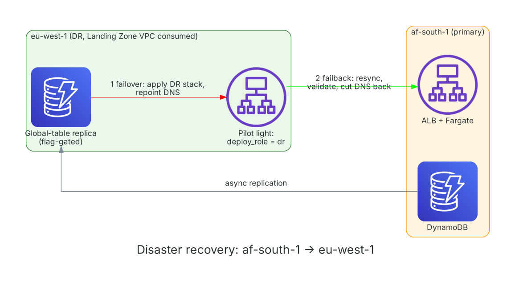

# Disaster recovery and resilience

**Diagram description:** primary in af-south-1, pilot light in eu-west-1. **Service inventory:** ALB, Fargate, DynamoDB global-table replica. **Data flow:** asynchronous replication of the URL table. **Landing Zone dependencies:** `eu_west_1` network; certificate and ECR for Ireland must be supplied (not exported).

| | Target | Basis |
|---|---|---|
| RPO | about 1 second with the replica (prod); otherwise the last PITR restore point | Global tables replicate asynchronously; PITR on |
| RTO | about 60 minutes | Design target: apply DR stack, push or replicate image, repoint DNS |
| Release rollback | minutes | Blue kept for 5 minutes after a successful shift |

**Failover:** confirm replica health; push the image to the eu-west-1 repository; apply with `deployment_role = "dr"`, `dr_image_repository`, `dr_acm_certificate_arn`; set `create_dns_record = true` in DR and remove the primary record (or accept the change in the zone); run `deploy`. **Failback:** resync from the replica, validate, cut DNS back, scale DR down.

Limits: pilot light, not active-active; DNS cut-over is manual; the DR run uses its own state file.
