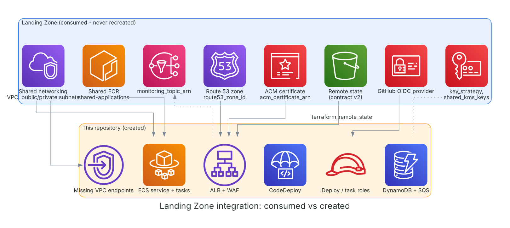

# Landing Zone integration

**Diagram description:** blue is consumed, amber is created; arrows show which Landing Zone output feeds which component. **Service inventory:** VPC, subnets, Route 53 zone, ACM certificate, shared ECR, GitHub OIDC provider, key strategy, alerts topic (consumed); ALB, WAF, ECS, CodeDeploy, DynamoDB, SQS, IAM roles, missing endpoints (created). **Data flow:** state is read at plan time. **Security controls mapping:** see threat-model.md.

## Consumed outputs
| Output | Used for |
|---|---|
| `af_south_1.vpc_id`, `vpc_cidr_block`, `public_subnet_ids`, `private_subnet_ids` | ALB, tasks, endpoints, SG rules |
| `eu_west_1.*` | DR deployment (`deployment_role = dr`) |
| `acm_certificate_arn` | ALB HTTPS listener |
| `route53_zone_id`, `route53_domain_name` | Alias record |
| `ecr_repository_urls["shared-applications"]` | Image repository |
| `github_oidc_provider_arn` | Deploy role trust |
| `key_strategy`, `shared_kms_keys` | DynamoDB and SQS encryption |
| `monitoring_topic_arn` | Rollback alarm notifications |
| `contract_schema_version` | Contract guard |

## Reused (looked up, never modified)
Subnets and their route tables (read to attach gateway endpoints), any VPC endpoint that already exists.

## Newly created
ALB, target groups, listeners, WAF web ACL and log group, ECS cluster/service/task definition/log group, task security group, CodeDeploy app and group, DynamoDB table, SQS queue and DLQ, IAM roles (execution, task, CodeDeploy, GitHub deploy), 5xx alarm, Route 53 record, missing VPC endpoints and their security group, optional budget.

## Gaps for the Landing Zone owner
1. `shared_kms_keys` ARNs are null: stage/prod plans fail by design. No `dynamodb` or `sqs` key domain.
2. No NAT and no interface endpoints: this repo creates the ones it needs.
3. `access_logs_bucket_name` is in us-east-1; ALB access logs need a same-region bucket (variable `alb_access_logs_bucket`).
4. No eu-west-1 certificate, ECR repository or KMS key export for DR (the replica needs its own CMK in prod).
5. `github_oidc_role_arns` is empty: no pipeline role to apply Terraform from CI.
6. State bucket location is not in the outputs.
7. The SNS topic policy must allow CloudWatch alarms to publish.
