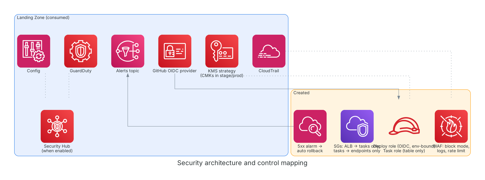

# Threat model (STRIDE summary)

**Diagram description:** consumed Landing Zone controls (blue) and controls added here (amber). **Service inventory:** WAF, ALB, security groups, IAM roles, CloudWatch alarm, plus Landing Zone KMS, Security Hub, GuardDuty, CloudTrail, Config. **Data flow:** WAF and ECS logs go to CloudWatch Logs; the 5xx alarm notifies the Landing Zone SNS topic. **Landing Zone dependencies:** key strategy, OIDC provider, alerts topic, trails.

| Threat | Control | Residual risk |
|---|---|---|
| Spoofing: workflow from another repo or branch assumes the deploy role | OIDC trust bound to `repo:<owner/repo>:environment:<env>`; prod environment reviewers | A compromised workflow in that environment |
| Tampering: malicious image deployed | Trivy gate (fail on HIGH/CRITICAL), Landing Zone ECR, task role cannot push | Base image supply chain |
| Repudiation | CloudTrail (Landing Zone), CodeDeploy history, WAF logs | Log buckets are in us-east-1 |
| Information disclosure | Private tasks, endpoints only, TLS 1.3 policy, redacted auth header, table-scoped task role | Application-layer URL content |
| Denial of service | WAF rate limit, ALB; no Shield Advanced | Volumetric attacks |
| Elevation | Deploy role scoped to one repository, one service, PassRole limited to two roles | `ecs:RegisterTaskDefinition` cannot be scoped |
| Bad release | Canary, 5xx alarm rollback, blue kept 5 minutes | Faults that do not produce 5xx |

Not covered: application authentication on `/shorten`, abuse of the open redirect, data classification.
